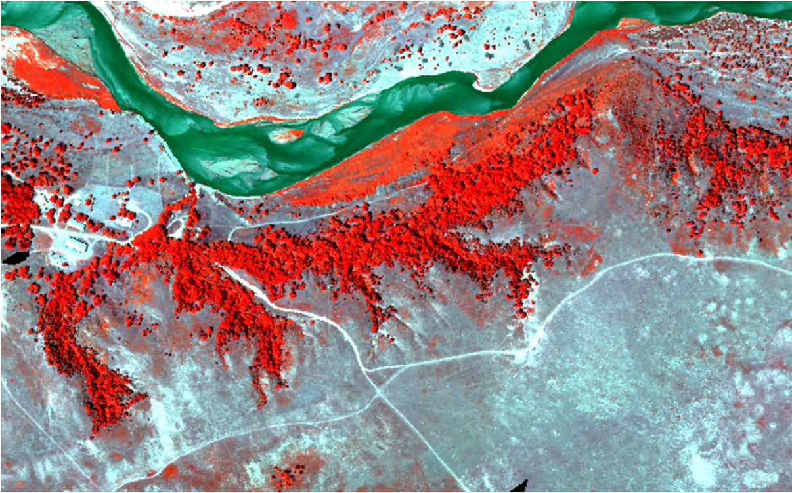

{.homepage-image}

## About Our Group

Our research explores ecosystem physiology and dynamics, examining on how biodiversity and environmental conditions shape ecosystem productivity, carbon exchange, and other ecological processes across spatial and temporal scales.

We integrate field measurements, eddy covariance, and multiscale remote sensing to understand terrestrial ecosystems and their responses to environmental change.

## Our Research

Explore our work on biodiversity, plant physiology,
carbon dynamics, environmental change, and
remote sensing methods.

[Explore our research →](research.qmd){.research-link}

---

## Open Science & Education

::: {.home-two-columns}

::: {.home-feature}
<i class="bi bi-mortarboard"></i>

### [Teaching](teaching.qmd)

Courses and educational activities
:::

::: {.home-feature}
<i class="bi bi-book"></i>

### [Open Science Commons](open-science.qmd)

Open data, resources, and tools
:::

:::

---

## People & Activities

::: {.home-two-columns}

::: {.home-feature}
<i class="bi bi-people"></i>

### [People](people.qmd)

Meet our group members and collaborators.
:::

::: {.home-feature}
<i class="bi bi-camera"></i>

### [Updates](updates.qmd)

Fieldwork, student milestones, and group activities.
:::

:::

---

## Contact

We welcome inquiries about research collaborations, student opportunities, and our open science resources.

**EcoRhythms Lab**

Led by Dr. Ran Wang

Assistant Professor

School of Natural Resources 

University of Nebraska–Lincoln  

Lincoln, Nebraska, USA

**Email:** [ranwang@unl.edu](mailto:ranwang@unl.edu)

Learn more about our group on the [People](people.qmd){.people-link} page.