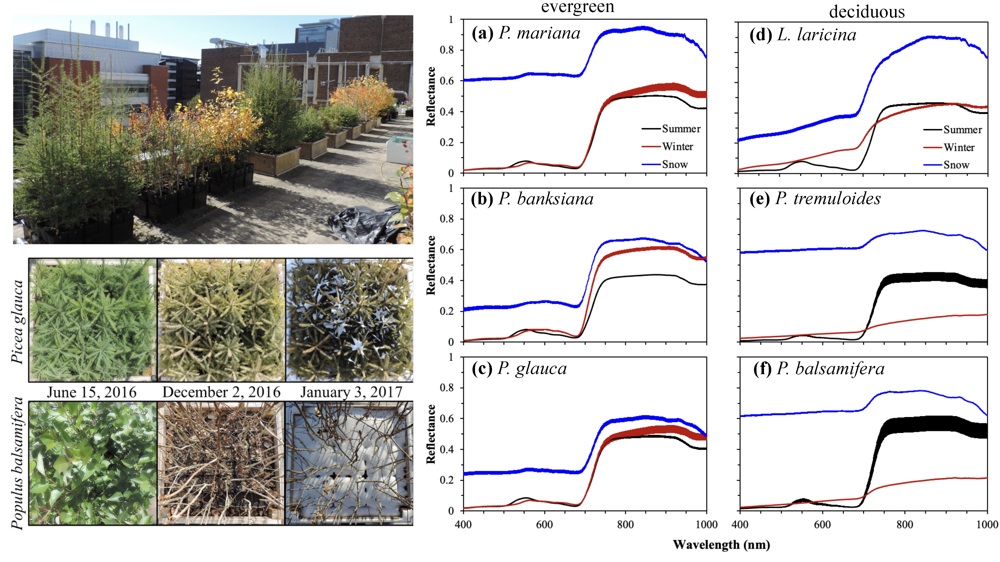
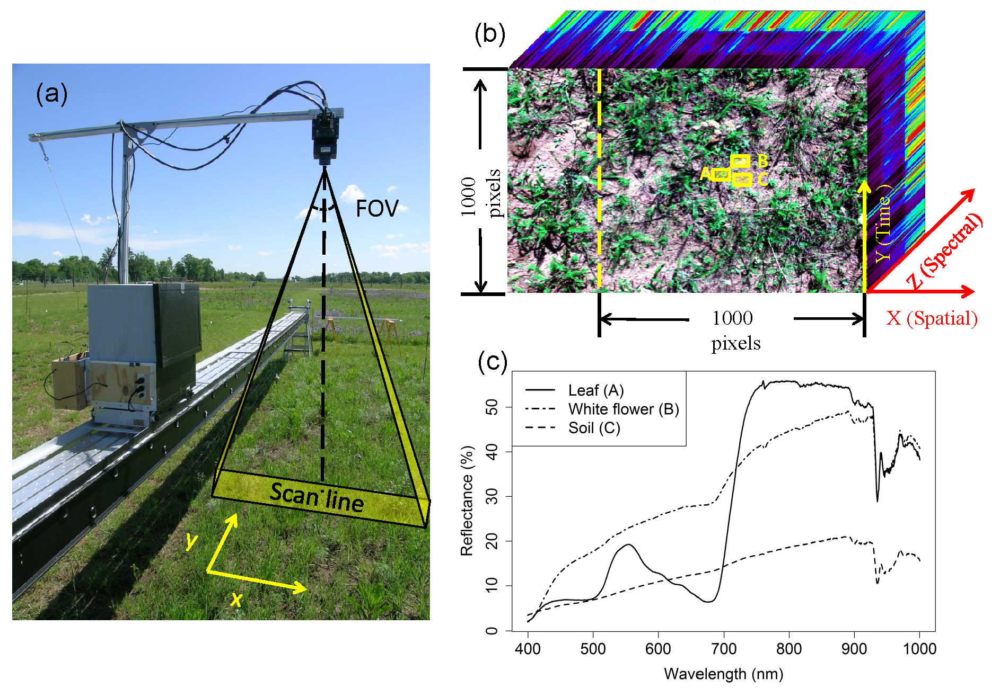
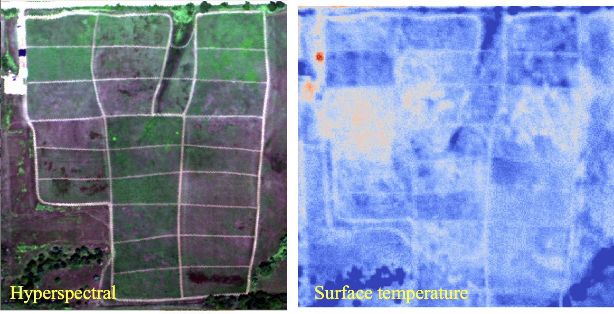
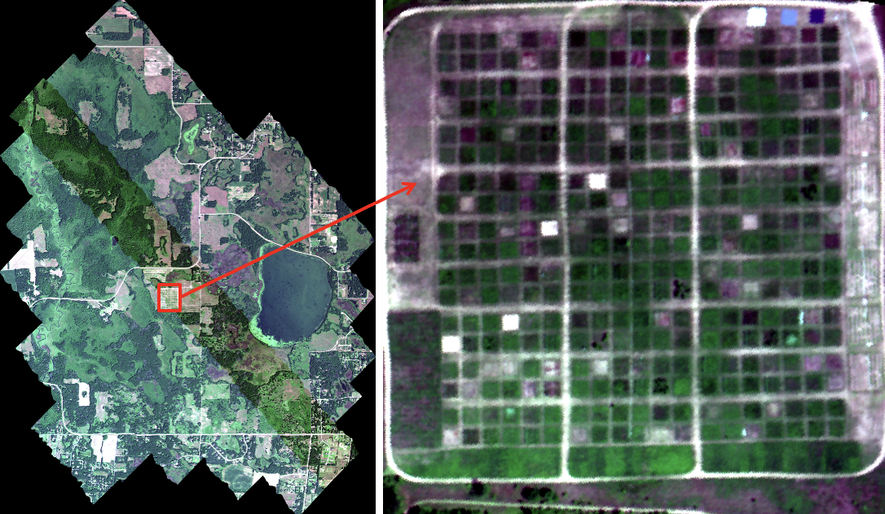

***We support open and reproducible research through sharing data, tools, and educational resources.***

## Open Data

### Field spectroscopy
#### Boreal tree experiment (Alberta, Canada)
Time series leaf level gas exchange and leaf- and canopy-level reflectance revealed snow impacts on reflectance, vegetation indices, and estimation of photosynthetic activity using remote sensing.
{#fig-UoArooftop}

**Wang, R.**, Springer, K. R. and Gamon. J.A. 2016. Leaf spectra of boreal tree species from Alberta potted tree experiment. Data set. Available on-line [http://ecosis.org] from the Ecological Spectral Information System (EcoSIS). DOI:10.21232/HbGMYtyz. [[*link*]](https://ecosis.org/package/leaf-spectra-of-boreal-tree-species-from-alberta-potted-tree-experiment)

**Wang, R.**, Springer, K. R. and Gamon. J.A. 2016. Canopy spectra of boreal tree species from Alberta potted tree experiment. Data set. Available on-line [http://ecosis.org] from the Ecological Spectral Information System (EcoSIS). DOI:10.21232/aY2V7zCr. [[*link*]](https://ecosis.org/package/canopy-spectra-of-boreal-tree-species-from-alberta-potted-tree-experiment)

#### Prairie diversity experiment (Minnesota, USA)
{#fig-TramData}

**Wang, R.** and Gamon, J.A. 2014. HWHYPCCMN1MM: Headwall Hyperspectral Reflectance LTER Cedar Creek Minnesota Multi-Year 1 mm V001. NASA EOSDIS Land Processes DAAC. DOI: 10.5067/Community/Headwall/HWHYPCCMN1MM.001. [[*link*]](https://www.earthdata.nasa.gov/data/catalog/lpcloud-hwhypccmn1mm-001)

**Wang, R.**, Gamon, J.A., and Cavender-Bares, J. 2014. Phenology Leaf Spectra Cedar Creek Biodiversity Experiment 2014. Data set. Available on-line [http://ecosis.org] from the Ecological Spectral Information System. EcoSIS. DOI:10.21232/i6N36jZ7. [[*link*]](https://ecosis.org/package/phenology-leaf-spectra-cedar-creek-biodiversity-experiment-2014)

**Wang, R.** and Gamon, J.A. 2014. Phenology Canopy Spectra Big Biodiversity Experiment Cedar Creek LTER 2014. Data set. Available on-line [http://ecosis.org] from the Ecological Spectral Information System. EcoSIS. DOI:10.21232/C2Z070. [[*link*]](https://ecosis.org/package/phenology-canopy-spectra-big-biodiversity-experiment-cedar-creek-lter-2014)

**Wang, R.** and Gamon, J.A. 2014. Whole Plot Canopy Spectra Big Biodiversity Experiment Cedar Creek LTER 2014. Data set. Available on-line [http://ecosis.org] from the Ecological Spectral Information System. EcoSIS. DOI:10.21232/C2T66F. [[*link*]](https://ecosis.org/package/whole-plot-canopy-spectra-big-biodiversity-experiment-cedar-creek-lter-2014)

### Airborne hyperspectral images
**Wang, R.**, Gamon, J.A., Kellar, P.R. 2025. High-Resolution Airborne Hyperspectral and Thermal Imagery of Bobcat Prairie, Nebraska, University of Nebraska–Lincoln. https://doi.org/10.71964/111. [[*link*]](https://sandy.unl.edu/record/111?v=zip)

{#fig-BobcatAir}

**Wang, R.**, Gamon, J.A., Russo, S.E. 2023. Airborne Hyperspectral Reflectance Indian Cave Nebraska Multi-Day 1 m V001. NASA EOSDIS Land Processes DAAC, https://doi.org/10.5067/Community/Airborne/AEHYPICNE1M.001. [[*link*]](https://www.earthdata.nasa.gov/data/catalog/lpcloud-aehypicne1m-001)

 in Nebraska, USA.](images/IndianCaveAir.png){#fig-ICAir}

Gamon, J.A. and **Wang, R.**. 2017. AEHYPCCMN300MM: Airborne Hyperspectral Reflectance LTER Cedar Creek Daily 300 mm V00. NASA EOSDIS Land Processes DAAC. DOI: 10.5067/Community/Airborne/AEHYPCCMN300MM.001. [[*link*]](https://www.earthdata.nasa.gov/data/catalog/lpcloud-aehypccmn300mm-001)

{#fig-CedarCreekAir}

### Satellite products 
Hmimina, G., Yu, R., **Wang, R.**, Huemmrich, K.F., Gamon, J.A. 2022. ABOVE: Light-Curve Modelling of Gridded GPP Using MODIS MAIAC and Flux Tower Data. ORNL DAAC, Oak Ridge, Tennessee, SA. https://doi.org/10.3334/ORNLDAAC/2024. [[*link*]](https://www.earthdata.nasa.gov/data/catalog/ornl-cloud-gpp-modis-alaska-canada-2024-1)

Yu, R., Hmimina, G., Huemmrich, K.F., Billesbach, D.P., Lyapustin, A., Wang, Y., Zhao, J., **Wang, R.**, Gamon, J.A. 2021. ABoVE: Angular-corrected MODIS MAIAC Reflectance across Alaska and Canada, 2000-2017. ORNL DAAC, Oak Ridge, Tennessee, USA. DOI:10.3334/ORNLDAAC/1858. [[*link*]](https://www.earthdata.nasa.gov/data/catalog/ornl-cloud-above-modis-maiac-reflectance-1858-1)

## Open Educational Resources

**Open-access textbook**

**Wang, R.**, Li, X., Husa, A. (2026) Mapping the world: An open textbook on GIS and remote sensing. Open Education Resources: Textbooks and Related Materials. https://digitalcommons.unl.edu/oerbooks/4/. Available at:https://open-spatial-science.github.io/intro-gis-rs/. [[*link*]](https://open-spatial-science.github.io/intro-gis-rs/)

<!-- 

## Tools & Workflows

Reusable R and Python scripts, geospatial analysis
workflows, and other scientific resources.

-->