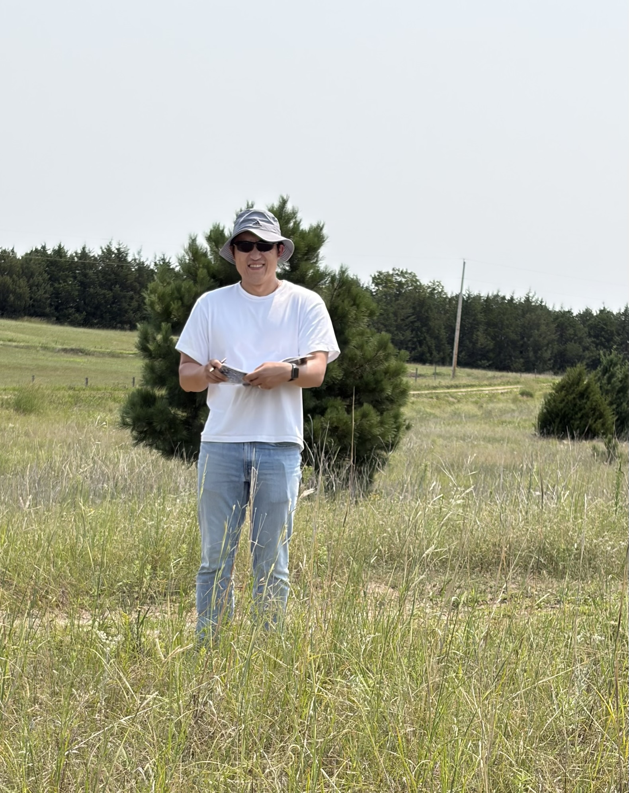
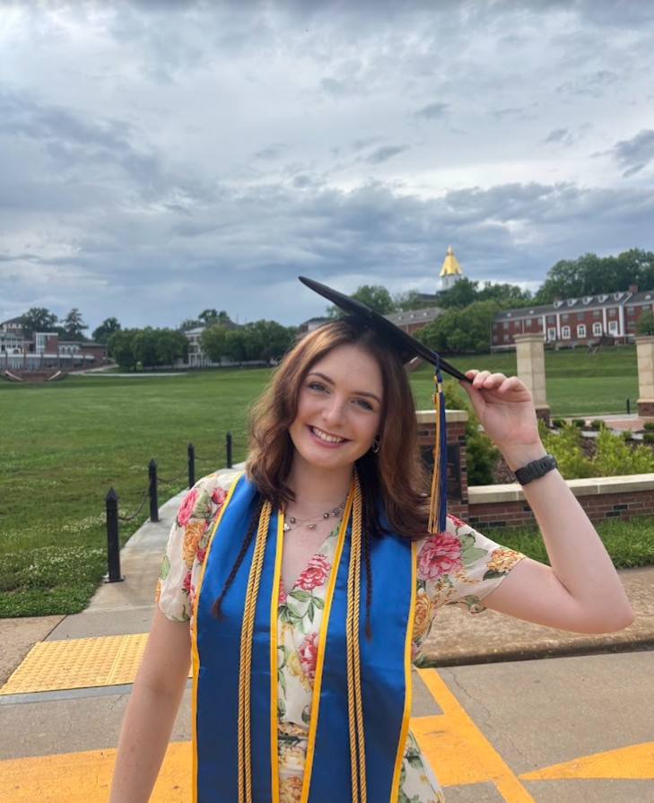
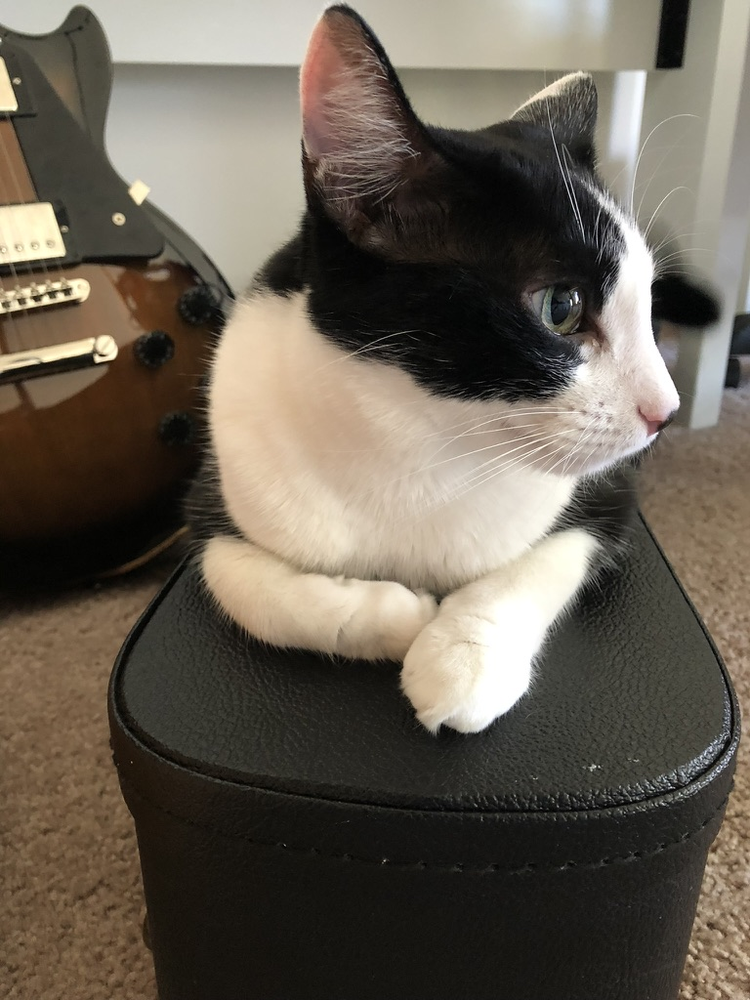

Meet the people contributing to our research. 

## Current Members
```{=html}
<div class="people-list">

  <div class="person">
    

    <div class="person-info">
      <h3>Ran Wang</h3>
      <p class="person-role">
        Assistant professor | Group Lead
      </p>
      <p>
        Research interests include ecosystem
        physiology, biodiversity, ecosystem
        functioning, and multiscale remote sensing.
      </p>
      <p class="person-links">
        <a href="https://scholar.google.com/citations?user=8Pv1GZgAAAAJ&hl=en">
          Google Scholar
        </a>
        <a href="https://orcid.org/0000-0002-3810-9103">
          ORCID
        </a>
      </p>
    </div>
  </div>

  <div class="person">
    

    <div class="person-info">
      <h3>Serge Tuyambaze</h3>
      <p class="person-role">
        Ph.D. Student
      </p>
      <p>
        Serge’s research focuses on using hyperspectral satellite data for terrestrial ecosystem productivity monitoring and disturbance detection. He also enjoys developing tech solutions. 
      </p>
      <p class="person-links">
        <a href="https://snr.unl.edu/aboutus/who/people/graduatestudent-member.aspx?pid=2859">
          Personal site
        </a>
      </p>
    </div>
  </div>

  <div class="person">
    

    <div class="person-info">
      <h3>Abigail Hightower</h3>
      <p class="person-role">
        M.Sc. Student
      </p>
      <p>
        I am originally from Georgia where I obtained an undergraduate degree in Geospatial Sciences. Now I am pursuing a graduate degree in Natural Resources Management specializing in remote sensing at the University of Nebraska. Through my education I hope use advancing technology to help decision makers create a sustainable future.
      </p>
      <p class="person-links">
        <a href="https://sites.google.com/view/abigailhgisportfolio/about/">
          Personal site
        </a>
      </p>
    </div>
  </div>

</div>
```
<!-- comment for now
## Recent Members

```{=html}
<div class="people-list">

  <div class="person">
    

    <div class="person-info">
      <h3>name</h3>
      <p class="person-role">
        Undergraduate Research Assistant | 2020–2022
      </p>
      <p>
        Contributed to ecological field measurements,
        geospatial analysis, and data processing.
      </p>
    </div>
  </div>

</div>
```
and -->.

## Honorary Members

```{=html}
<div class="people-list">

  <div class="person">
    

    <div class="person-info">
      <h3>Jingle</h3>
      <p class="person-role">
        Chief science advisor
      </p>
      <p>
        Specializes in supervising data analyzing and writing sessions.<br>
        Motto: "<strong>Veni, vidi, iudicavi</strong>" <em>(I came, I saw, I judged)</em>.
      </p>
    </div>
  </div>

</div>
```