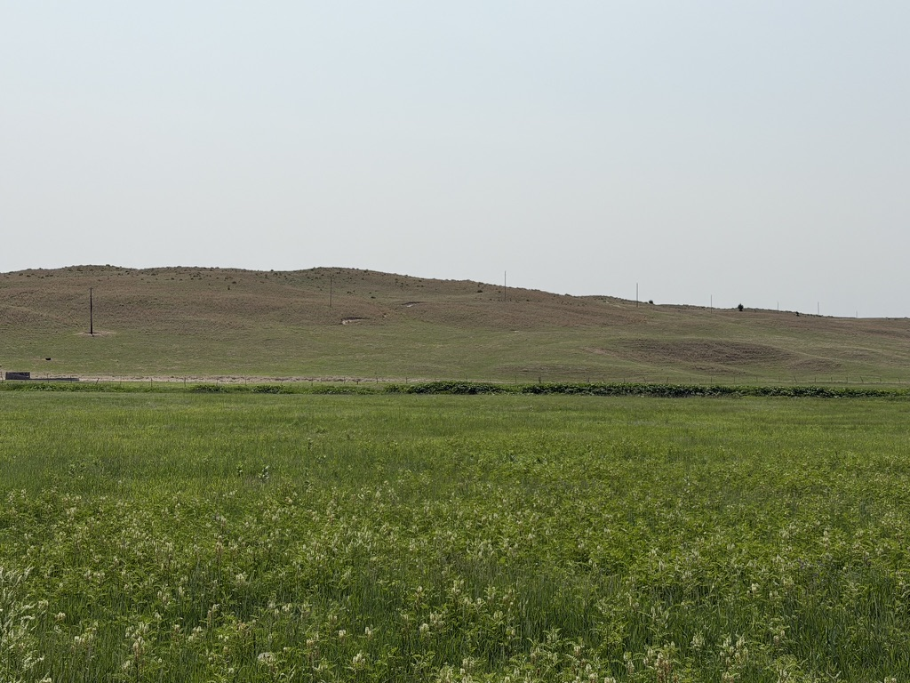
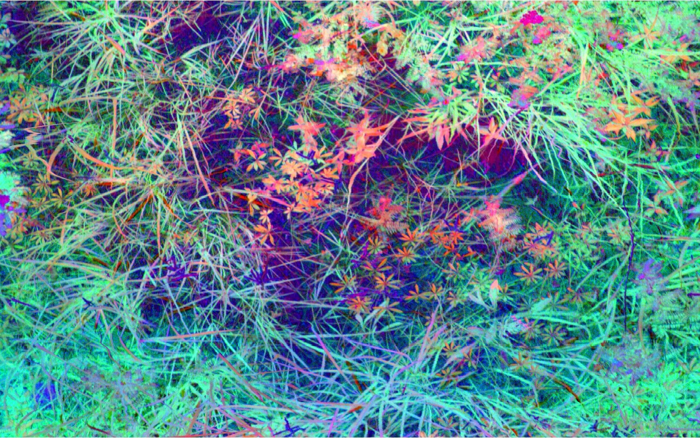
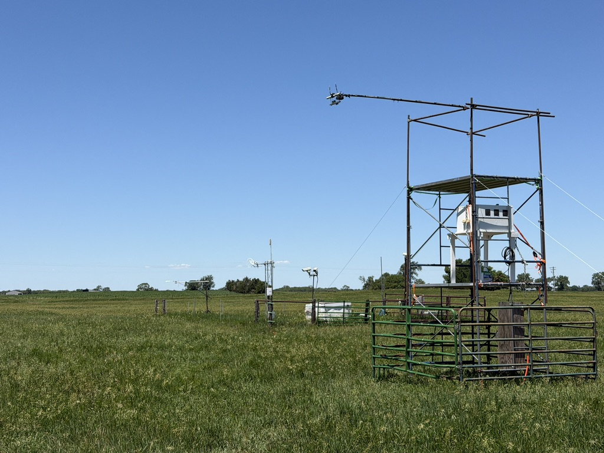
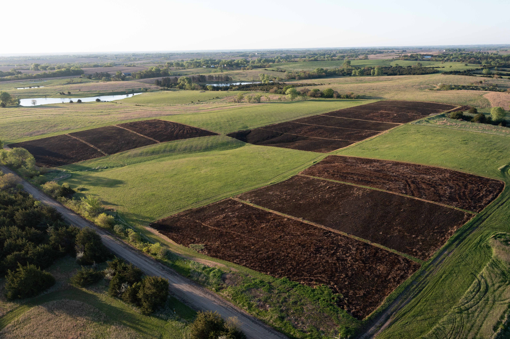
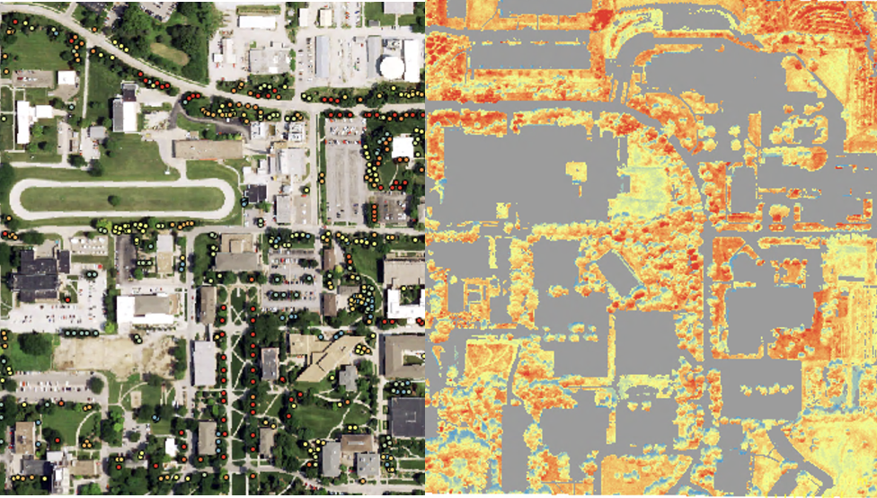
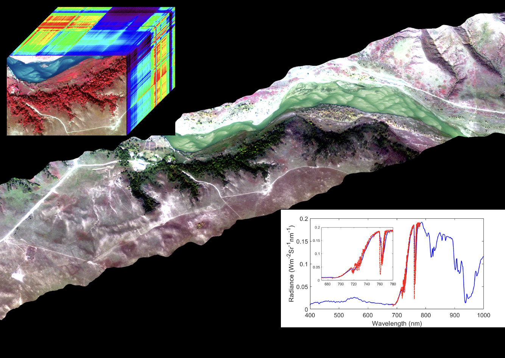
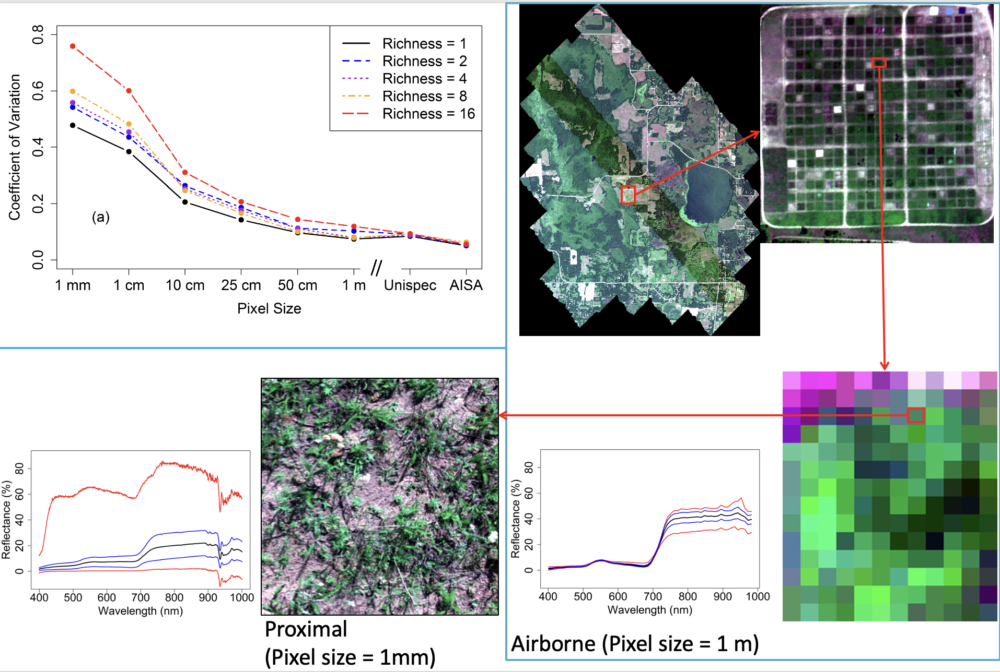
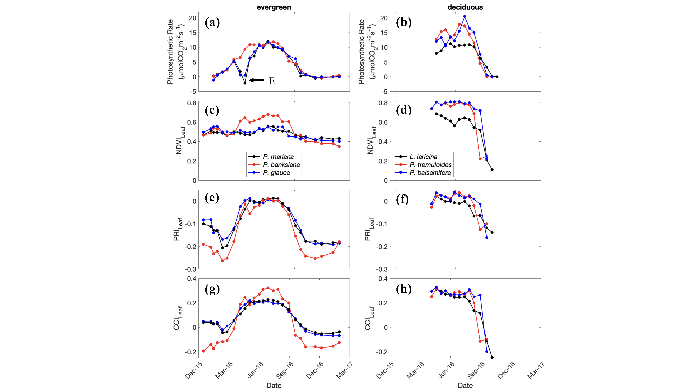
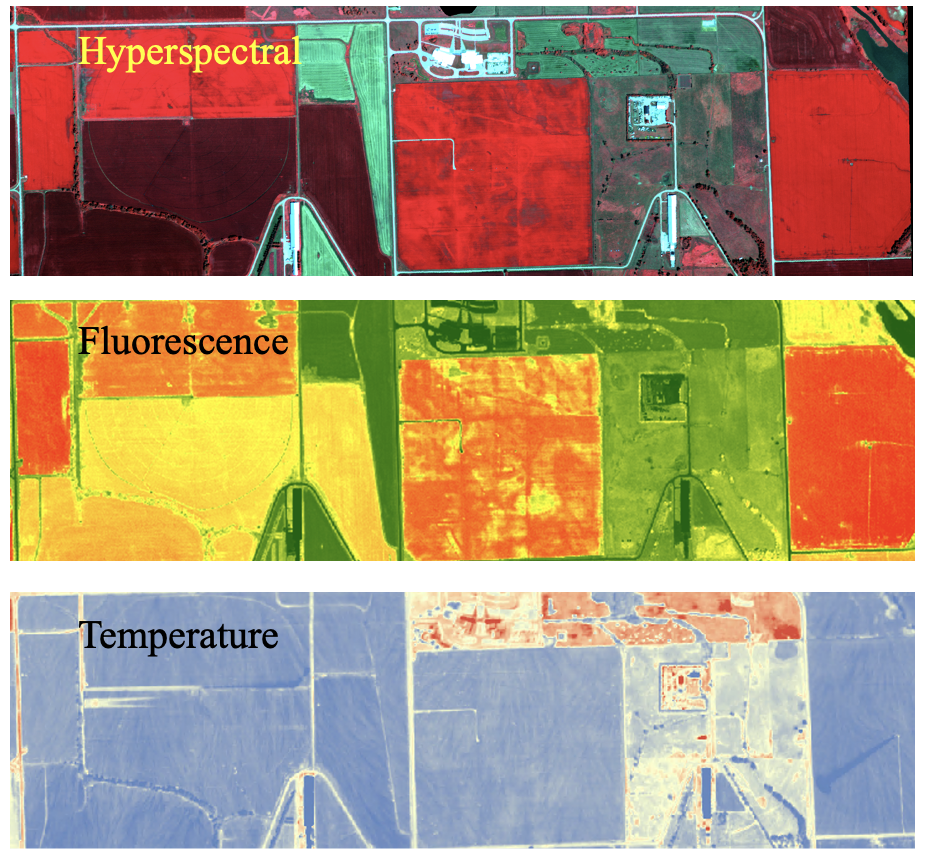

**Our research investigates the patterns, processes, and dynamics of terrestrial ecosystems through field measurements, eddy covariance, and multiscale remote sensing.**

A full list of publications can be found at [*Google Scholar*](https://scholar.google.com/citations?user=8Pv1GZgAAAAJ&hl=en).

```{=html}
<div class="research-grid">

  <a class="research-card" href="#biodiversity">
    
    <h3>Biodiversity & Ecosystem Functioning</h3>
    <p>Understanding how plant diversity, functional traits, and vegetation structure influence ecosystem processes.</p>
  </a>

  <a class="research-card" href="#physiology">
    
    <h3>Vegetation Physiology</h3>
    <p>Investigating how plants regulate photosynthesis, photoprotection, and carbon exchange in response to environmental conditions.</p>
  </a>

  <a class="research-card" href="#productivity">
    
    <h3>Ecosystem Productivity & Carbon Exchange</h3>
    <p>Investigating ecosystem productivity and carbon exchange across ecosystems using eddy covariance and remote sensing.</p>
  </a>

  <a class="research-card" href="#environmental-change">
    
    <h3>Ecosystem Dynamics & Environmental Change</h3>
    <p>Exploring how ecosystems respond to climate variability, disturbance, and land management.</p>
  </a>

  <a class="research-card" href="#urban-ecosystem">
    
    <h3>Urban Ecosystems & Climate</h3>
    <p>Studying how vegetation and built environments interact to shape urban thermal conditions, energy use, and environmental sustainability.</p>
  </a>

  <a class="research-card" href="#rs-method">
    
    <h3>Imaging Spectroscopy & Remote Sensing Methods</h3>
    <p>Developing and evaluating methods for airborne imaging spectroscopy, solar-induced fluorescence retrieval, atmospheric correction, and thermal image processing to improve environmental monitoring.</p>
  </a>

</div>
```

## Biodiversity & Ecosystem Functioning {#biodiversity}

Our research investigates patterns of plant biodiversity and their relationships with ecosystem structure and functioning across spatial scales. We integrate field-based vegetation surveys, plant functional traits, and multiscale remote sensing to characterize species and functional diversity, examine their environmental drivers, and explore how biodiversity influences ecosystem processes. This work aims to improve our understanding of biodiversity–ecosystem functioning relationships and support ecosystem monitoring and conservation.

{#fig-scalebiodiversity}


**Selected publications**

McNichol, B. H., **Wang, R.**, Hefner, A., Helzer, C., McMahon, S. M., Russo, S. E. (2024). Topography-driven microclimate gradients shape forest structure, diversity, and composition in a temperate refugial forest. *Plant-Environment Interactions*, 5, e10153.  

**Wang, R.**, Gamon, J. A., Cavender-Bares, J. (2022). Seasonal patterns of prairie spectral diversity at leaf and canopy scales. *Remote Sensing of Environment*, 280, 113169.

**Wang, R.** and Gamon, J.A. (2019). Remote sensing of terrestrial plant biodiversity. *Remote Sensing of Environment*, 231: 111218. 

**Wang, R.**, Gamon, J. A., Cavender-Bares, J., Townsend, P. A., Zygielbaum, A. I. (2018). The spatial sensitivity of the spectral diversity-biodiversity relationship: an experimental test in a prairie grassland, *Ecological Applications*, 28(2): 541–556.

## Vegetation Physiology {#physiology}

Our research explores how plants regulate photosynthesis, photoprotection, and resource use in response to changing environmental conditions. We combine leaf-level physiological measurements with canopy observations, imaging spectroscopy, and solar-induced chlorophyll fluorescence to characterize vegetation functional responses across spatial and temporal scales. This type of work seeks to improve our understanding of plant physiological processes and develop remote sensing indicators of vegetation functioning and stress.

{#fig-timeleafdata}

**Selected publications**

**Wang, R.**, Springer, K.R., Gamon J.A. (2023) Confounding effects of snow coverage on remotely sensed vegetation indices of evergreen and deciduous trees: an experimental study. *Global Change Biology*, 29, 6120-6138.

Gamon J. A., **Wang, R.**, Russo, S. E. (2023) Contrasting photoprotective responses of forest trees revealed using PRI light responses sampled with airborne imaging spectrometry. *New Phytologist*, 238 (3), 1318-1332. 

## Ecosystem Productivity & Carbon Exchange {#productivity}

Our research investigates the spatial and temporal dynamics of ecosystem productivity and carbon exchange across grassland and forest ecosystems. We integrate eddy covariance measurements, field observations, and multiscale remote sensing to assess photosynthetic productivity, light-use efficiency, and their responses to environmental variability. We also examine how seasonal changes, including snow cover, affect remotely sensed vegetation signals and the monitoring of ecosystem productivity. This work aims to improve our understanding and assessment of ecosystem carbon dynamics across vegetation types and environmental conditions.

{#fig-snowonVI}

**Selected publications**

**Wang, R**, Bowling, D.R., Gamon, J.A., Smith, K.R., Yu, R., Hmimina, G., Ueyama, M., Noormets, A., Kolb, T.E., Richardson, A.D., Bourque, CP-A, Braho, R., Blanken, P.D., Black, T.A. (2023). Snow-corrected vegetation indices for improved gross primary productivity assessment in North American evergreen forests. *Agricultural and Forest Meteorology*, 340, 109600.

**Wang, R.**, Gamon, J. A., Emmerton, C. A., Springer, K. R., Yu, R., & Hmimina, G. (2020). Detecting intra- and inter-annual variability in gross primary productivity of a North American grassland using MODIS MAIAC data. *Agricultural and Forest Meteorology*, 281, 107859. 

## Ecosystem Dynamics & Environmental Change {#environmental-change}

Our research examines how land management and environmental change influence biodiversity, ecosystem function, and surface-atmosphere feedbacks, with a particular focus on grassland ecosystems. This work aims to improve our understanding of ecosystem responses to management and environmental change, including their implications for ecosystem resilience and climate feedbacks.

{#fig-bobcatresults}

**Selected publications**

Gholizadeh, H., Sams, A., Rakotoarivony, M., Weerasuriya, N., Struble, E., Freese, C., Shepard, A., Islam, S., Foroutan, E., Brown, T., Rossi, C., Hamilton, R., Fuhlendorf, S., McMillan, N., **Wang, R.**, Bachelot, B., Gamon, J. (2026) Spaceborne imaging spectroscopy advances modeling of grazer resource selection. *International Journal of Applied Earth Observation and Geoinformation*. 152: 105421.

**Wang, R.**, Gamon J. A., Hogan K. F. E., Kellar P. R., Wedin D. A. (2025). Management practices influence biodiversity, productivity and surface-atmosphere feedbacks in tall-grass prairie. *New Phytologist*. 247(2): 562-576.

## Urban Ecosystems & Climate {#urban-ecosystem}

Our research explores how urban vegetation and the built environment influence ecosystem functioning, thermal conditions, and energy use. We integrate airborne remote sensing, field observations, and spatial analysis to investigate urban tree physiology and potential indicators of tree health, as well as the effects of tree cover and roof characteristics on urban temperatures and building energy consumption. These efforts aim to improve our understanding of urban ecosystem processes and inform strategies for urban sustainability and climate adaptation.

{#fig-urbantreehealth}


**Selected publications**

**Wang, R.**, Gamon, J. A., Russo, S. E., Valentin, A., Ellerman, H., Wardlow, B. (2024). Multitemporal airborne imaging spectrometry and fluorometry reveal contrasting photoprotective responses of trees. *Remote Sensing of Environment*, 311, 114295.


## Imaging Spectroscopy & Remote Sensing Methods {#rs-method}

We develop and evaluate **airborne** remote sensing methods to improve the accuracy and interpretation of environmental observations. Our methodological research includes solar-induced fluorescence (SIF) retrieval, atmospheric correction of imaging spectroscopy data, and processing of thermal imagery. These efforts help bridge sensor measurements and the ecological processes they represent.

{#fig-ImageAnalysis}

**Selected publications**

*Airborne thermal imagery processing*

**Wang, R.**, Gamon J. A., Hogan K. F. E., Kellar P. R., Wedin D. A. (2025). Management practices influence biodiversity, productivity and surface-atmosphere feedbacks in tall-grass prairie. *New Phytologist*. 247(2): 562-576.

*Airborne SIF retrieval*

**Wang, R.**, Gamon J. A., Hmimina, G., Cogliati, S., Zygielbaum, A. I., Arkebauer, T. J., Suyker, A. (2022). Harmonizing solar induced fluorescence across spatial scales, instruments, and extraction methods using proximal and airborne remote sensing: A multi-scale study in a soybean field. *Remote Sensing of Environment*, 281, 113268.

*Atmospheric correction applied to airborne imaging spectroscopy data*

**Wang, R.**, Gamon, J. A., Moore, R., Zygielbaum, A. I., Arkebauer, T. J., Perk, R., Leavitt, B., Cogliati, S., Wardlow, B., Qi, Y. (2021). Errors associated with atmospheric correction methods for airborne imaging spectroscopy: Implications for vegetation indices and plant traits. *Remote Sensing of Environment*, 265, 112663. 