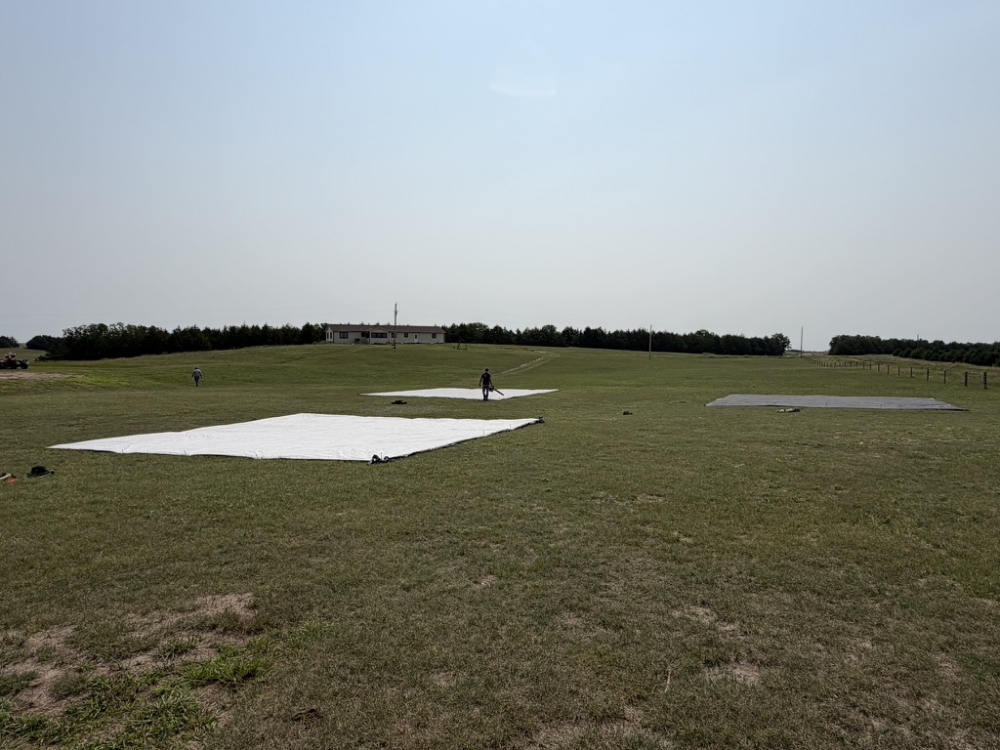
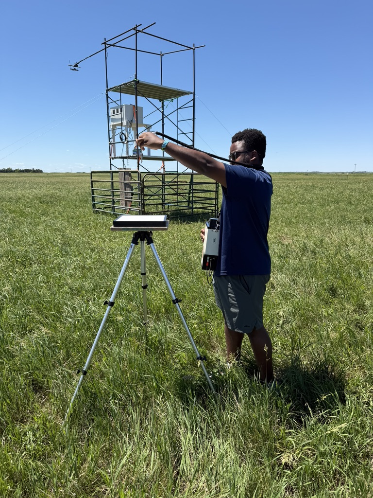
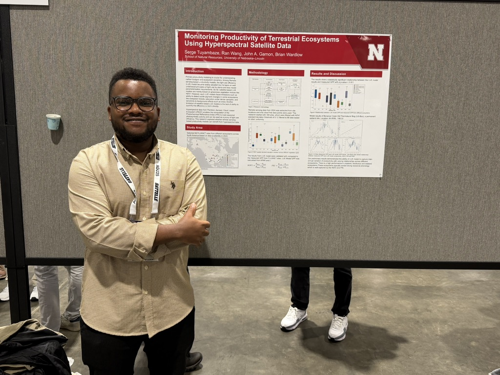

A glimpse into our fieldwork, research activities, and the people behind the science.

```{=html}
<div class="updates-list">

  <div class="update-item">
    <div class="update-date">August 2026</div>
    <div class="update-content">
      <h3>Airborne campaign in the Nebraska Sandhills</h3>
      <p>Setting up calibration tarps for airborne imaging spectrascopy data collection at the Barta Brothers Ranch.</p>
      
    </div>
  </div>

  <div class="update-item">
    <div class="update-date">June 2026</div>
    <div class="update-content">
      <h3>Grassland fieldwork</h3>
      <p>Serge collects field spectroscopy measurements at the ENREEC LTAR pasture site.</p>
      
    </div>
  </div>

  <div class="update-item">
    <div class="update-date">June 2026</div>
    <div class="update-content">
      <h3>Abbey joined the group</h3>
      <p>Abigail (Abbey) Hightower joined the group as a new M.Sc. student. Welcome Abbey!</p>
    </div>
  </div>

  <div class="update-item">
    <div class="update-date">April 2026</div>
    <div class="update-content">
      <h3>Serge successfully defended his M.Sc. thesis</h3>
      <p>CONGRATULATIONS to Serge on successfully defending his M.Sc. thesis! He will continue his studies at UNL as a Ph.D. student.</p>
    </div>
  </div>

  <div class="update-item">
    <div class="update-date">December 2025</div>
    <div class="update-content">
      <h3>Serge presented at AGU</h3>
      <p>Serge presented his research at the 2025 AGU Fall Meeting in New Orleans.</p>
      
    </div>
  </div>

</div>
```